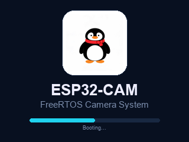
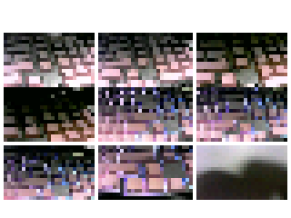
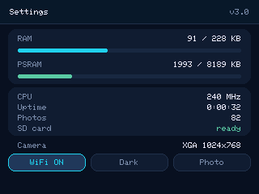
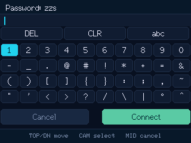
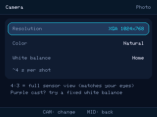

# ESP32-CAM-AI

基于 **ESP32-S3 + OV5640** 的单板智能相机：FreeRTOS 双核调度、自研轻量 UI 框架（深/浅双主题）、
本地相册、三款小游戏、WiFi 图传与局域网调参。整套交互只用板载 4 个按键，不依赖触摸屏。



## 功能

| 模块 | 说明 |
|---|---|
| **相机** | OV5640 实时取景 + 拍照存 TF 卡；分辨率 / 色彩风格 / 白平衡三档可调，NVS 记忆 |
| **相册** | 3×3 九宫格 + 全屏预览；三级解码加速（缩略图 → 预解码缓存 → 全图解码） |
| **游戏** | 俄罗斯方块 / 贪吃蛇 / 2048，最高分存 TF 卡 |
| **备忘** | 板载新建与编辑，落盘 TF 卡 |
| **设置** | WiFi 热点与 STA 连接、主题切换、拍照参数 |
| **Web** | AP/STA 双模，局域网 MJPEG 推流 + 网页控制 |

| | |
|---|---|
|  |  |
|  |  |

## 硬件

| 器件 | 型号 / 参数 | 接口 |
|---|---|---|
| 主控 | ESP32-S3 N8R8（8 MB Flash + 8 MB PSRAM） | — |
| 摄像头 | OV5640，8-bit 并口 DVP | esp32-camera 驱动 |
| 屏幕 | ST7789 240×320 IPS，横屏 320×240 | SPI（同步推屏） |
| 存储 | TF 卡 | 独立 HSPI：13/14/12/11 |
| 按键 | 4 键（上 / 下 / 确认 / 返回） | GPIO 10 / 9 / 8 / 7，中断 + 状态机 |
| 补光 | 白光 LED（低有效） | GPIO 6 |

## 软件架构

Arduino 框架 + PlatformIO 构建。FreeRTOS 双核分工：核 1 跑交互与渲染，核 0 跑采集与写盘，
避免 SPI 推屏阻塞摄像头 DMA。

| 任务 | 核 | 职责 |
|---|---|---|
| `key` | 1 | 按键扫描状态机、长按连发、组合键 |
| `disp` | 1 | App 调度、UI 绘制、JPEG 解码 |
| `cam` | 0 | 摄像头初始化、取景帧获取 |
| `stream` | 0 | MJPEG 推流（Web 端取景） |
| `sdw` | 0 | 照片异步写盘（与解码解耦） |
| `loop` | — | Arduino 主循环，WebServer 请求处理 |

三条数据通路：

```
OV5640 ──DVP──> cam task ──┬─> LCD 取景（RGB565 直推）
                           ├─> MJPEG 推流（WebSocket/HTTP）
                           └─> 拍照 → JPEG 缓冲 → sdw task → TF 卡
```

### 关键设计

- **主题系统**（`src/theme.h` / `theme.cpp`）：一套语义化色板 token（`bg` / `surface` / `selBg` /
  `accent` / `muted` …），`Drawer` 抽象屏蔽 Sprite 与直写屏幕的差异。深/浅两套配色经 NVS 持久化，
  所有界面（含 OSD、键盘、状态条）统一取色，不存在硬编码颜色。
- **相册三级加速**：小图缩略 → 目标页预解码进 PSRAM 缓存 → 缓存未命中才全图解码。快速滚动时
  `s_gridPendMask` 位图记录待解码格，松手后再补齐，滑动不卡顿。
- **拍照色彩稳定性**：传感器 `deinit → init` 后 AWB/AEC 统计窗口为空，若立即抓帧会得到
  "上一场景残留增益"，表现为同一场景连拍色温跳变。拍照前按时间预算连续丢帧收敛
  （≤XGA 900 ms / 10 帧），实测连拍 R/G 比从 1.05~1.34 收敛到 1.16/1.16。
- **JPEG 完整性校验**：回扫文件尾部 1 KB 查找 `FF D9`，残图不进入解码器 —— 截断的 JPEG
  解码不会报错，只会让后半段 MCU 整块变黑，必须在解码前拦截。

## 构建

```bash
# 依赖：PlatformIO Core（VSCode 插件或 pip 安装）
pio run                      # 编译
pio run -t upload            # 烧录（默认串口）
pio device monitor -b 115200 # 串口日志
```

`platformio.ini` 中已固定 TFT_eSPI 引脚与驱动配置，无需改库内 `User_Setup.h`。

## 串口调试命令

波特率 115200。这些命令在 UI 之外提供旁路控制，用于无人值守测试与抓图核对。

| 命令 | 作用 |
|---|---|
| `app N` | 切换到第 N 个 App |
| `snap` | 触发一次拍照 |
| `psize N` | 切换拍照分辨率档位 |
| `wb N` | 切换白平衡档位 |
| `theme d\|l` | 切换深/浅主题 |
| `gk up\|down\|cam\|drop` | 注入一次按键 |
| `shot` | 整帧回传当前 Sprite（RLE + Base64） |
| `fshot` | 回传相册全屏缓存像素 |
| `gshot` | 回传九宫格缓存（1/4 抽样） |

`shot` / `fshot` / `gshot` 配合 `tools/` 下的 Python 脚本，可在没有摄像头对准屏幕的情况下
自动核对 UI 渲染结果。

## 目录结构

```
src/
  main.cpp          启动流程、开机自检
  rtos_app.cpp      任务创建、串口命令行
  lcd_app.cpp       相册 / 相机 UI、JPEG 解码、屏幕回传
  ui_app.cpp        桌面 / 设置 / 备忘 / WiFi 子界面
  game_app.cpp      三款游戏
  theme.h/.cpp      主题色板与绘制原语
  camera_app.cpp    传感器初始化、拍照流程、参数档位
  web_app.cpp       WebServer、WiFi 管理、MJPEG 推流
  sd_app.cpp        TF 卡挂载与文件操作
assets/             图标素材与转换脚本
docs/ui-preview/    UI 渲染截图
tools/              串口抓图与 UI 验证脚本
```

## 已知限制

- **SXGA 1280×1024 不可用于日常拍照**：该时序下单帧耗时 2.2 s（0.45 fps），拍照约 11 s。
  默认档位为 XGA 1024×768（4:3 全画幅，约 3.6 s）。
- 单次拍照需重启传感器（约 3.5 s）。拍照流程目前仍在按键任务内执行，期间屏幕不刷新、
  按键无响应；后续计划拆分为独立 `photoTask` 并把摄像头状态机收口。
- 弱光下 OV5640 自动白平衡易漂移，可在设置里切固定白平衡档兜底。
